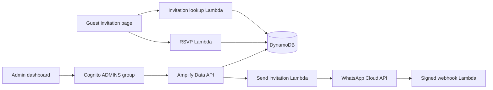

# Wedding Invitation System

A portfolio project combining a custom wedding invitation experience with guest management, RSVP collection, WhatsApp invitations, and seating planning. All event details and demo data in this repository are fictional.

## Try the invitation demo

Requires Node.js 22.12 or newer.

```sh
npm ci
npm run dev
```

Open the URL printed by Vite with `?code=demo`. The invitation and RSVP flow use an in-memory adapter: no AWS account, sign-in, message sending, or database is required. Refreshing resets the response. Other codes show the invalid invitation state.

For a complete frontend build, create a local placeholder configuration first:

```sh
cp amplify_outputs.example.json amplify_outputs.json
npm run build
```

The placeholder allows bundling the admin page; it does not enable admin sign-in. The admin dashboard requires your own deployed backend.

## Features

- Responsive invitation, countdown, schedule, dress palette, and two-step RSVP form.
- Party-size allocation and additional guest name validation.
- Cognito authentication and an ADMINS group for guest management.
- Invitation search, sorting, selection, and bulk WhatsApp invitation sending.
- Persistent seating tables, assignment management, and capacity checks in the UI.
- WhatsApp callback verification and signed payload validation.

## Architecture



The guest-facing API uses custom operations rather than exposing direct model access. Invitation codes act as bearer links. Admin model operations require the ADMINS group. The frontend uses vanilla JavaScript and CSS with Vite; infrastructure is defined in TypeScript with Amplify Gen 2.

## Run your own backend

1. Configure your own AWS credentials and run `npm run sandbox`. This provisions billable AWS resources and generates your own ignored `amplify_outputs.json`.
2. Configure the three named Amplify sandbox secrets referenced in the function resources: `meta_access_token`, `meta_webhook_verify_token`, and `meta_app_secret`. `.env.example` lists names only; it does not configure Amplify secrets.
3. Replace the Meta phone-number placeholder and template settings in the send and webhook function resources. Replace the `example.com` image URL in the send handler with an image you host and register your own approved WhatsApp template.
4. Create a Cognito user in your own environment and assign the ADMINS group. Visit `/admin/` to manage fictional invitations and seating tables.
5. To connect the guest frontend, replace the demo-client import at the top of `script.js` with Amplify configuration and `generateClient()` using your generated outputs, following the pattern in `admin/admin.js`.
6. Configure Meta callbacks using your generated webhook function URL and your own verification token. Keep secret values out of source control.

Use `examples/invitations.json` as fictional record examples for your own sandbox. They are not imported automatically and must never be sent to real recipients.

## Design preview

(images/[WhatsApp Video 2026-10-12 at 06.37.37.mp4](https://github.com/bennymuguruka/GxC-Wedding-Showcase/blob/main/images/WhatsApp%20Video%202026-10-12%20at%2006.37.37.mp4))

The original personal photographs and invitation artwork have been replaced. Actual application screenshots and a recorded walkthrough have not yet been added.

## Current limitations

WhatsApp webhook events are verified and logged but do not yet update delivery status in the dashboard. Seating capacity enforcement is in the UI. The local adapter covers the guest flow; the admin dashboard and cloud functions require a separate backend. A browser demo build is not proof that AWS or Meta integrations have been deployed and tested.

## Repository scope

This is an independent snapshot with fresh Git history. It excludes production configuration, personal photographs, banking details, guest records, production identifiers, and private handoff notes.
